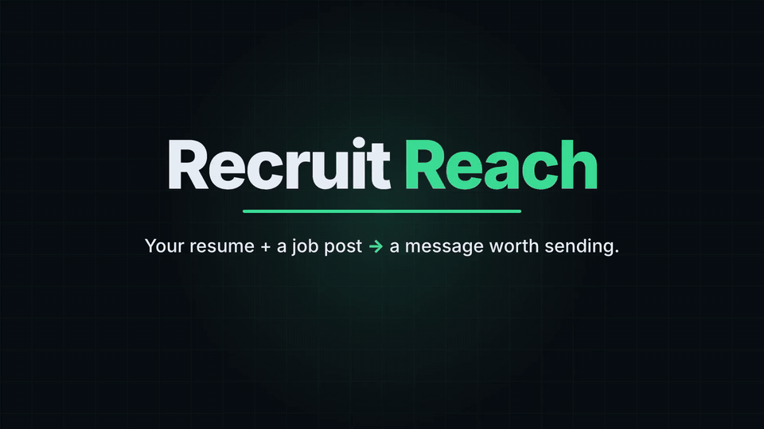

# RecruitReach


**Turn your resume and a job post into a short, personal LinkedIn message to the recruiter.**
RecruitReach is a Django REST API and a command-line tool. It reads your resume, picks the projects and skills that best match the job, and writes a connection note, InMail or follow-up that fits LinkedIn's length limits.

<!-- Add a GIF of the CLI here:  -->

```text
$ python cli/recruitreach.py --resume cv.docx --company Intuit --recruiter "Franklin" --type connection_note
Paste the job post, then press Ctrl-D on a new line (Windows: Ctrl-Z, then Enter):
<paste the job post, then Ctrl-D>
Hi Franklin, I’m Abdulkarim, a Computing Science student at Thompson Rivers University. Given Intuit's AI-powered tax assistant work, I wanted to connect. I recently built a Python AI-powered note assistant using MCP to orchestrate AI agents for data pipelines. I’d love to chat!

(279 characters, connection_note)
```

RecruitReach runs on your own machine with **your own Gemini API key**. Nothing is stored: the resume is read in memory and discarded.

## Tech stack

Python 3.14 · Django · Django REST Framework · Google Gemini (`google-genai`) · python-docx · drf-spectacular (Swagger docs) · argparse + requests (CLI) · pytest · Ruff · GitHub Actions

## Getting started

You need Python 3.14 and a free Gemini API key from [Google AI Studio](https://aistudio.google.com/apikey).

```bash
git clone https://github.com/AbdulkarimMziya/Recruit_Reach.git
cd Recruit_Reach
python -m venv .venv
source .venv/bin/activate          # Windows: .venv\Scripts\activate
pip install -r requirements.txt

cp .env.example .env               # then fill it in (see below)
python manage.py migrate           # creates Django's built-in tables only
python manage.py runserver
```

Fill in `.env`:

| Setting | What to put |
| --- | --- |
| `SECRET_KEY` | any long random string: `python -c "import secrets; print(secrets.token_urlsafe(50))"` |
| `AI_API_KEY` | your own Gemini API key |
| `AI_MODEL` | a Gemini Flash-Lite model, e.g. `gemini-3.5-flash-lite` |

The Gemini free tier has daily request limits; each message uses one or two requests.

## Using the CLI

With the server running, open a second terminal:

```bash
python cli/recruitreach.py --resume "/path/to/your resume.docx" \
  --company Shopify --recruiter "Sarah Lee" --type connection_note
```

Paste the job post when asked, press **Enter**, then **Ctrl-D**. Or pipe it in:

```bash
pbpaste | python cli/recruitreach.py --job - --resume cv.docx --company Shopify --recruiter "Sarah Lee" --type inmail
```

| Option | Required | Values |
| --- | --- | --- |
| `--resume` | yes | path to a `.txt` or `.docx` resume |
| `--job` | no | path to a text file, or `-` to read from a pipe; leave it out to paste |
| `--company` | yes | company name |
| `--recruiter` | yes | recruiter's name |
| `--type` | yes | `connection_note` (≤300 chars), `inmail` (≤1000), `follow_up` (≤500) |
| `--tone` | no | `friendly` (default), `formal`, `brief` |
| `--api-url` | no | default `http://127.0.0.1:8000` |

Errors print one line (e.g. `Error: can't reach the API ... Is the server running?`) and exit with code 1. Run `python cli/recruitreach.py --help` for details.

AI coding agents can use the CLI too: see [AGENTS.md](AGENTS.md).

## The API

Interactive docs (Swagger) are at **http://127.0.0.1:8000/api/docs/** while the server runs; use **Try it out** to generate a message in the browser.

| Method | Path | What it does |
| --- | --- | --- |
| GET | `/api/health/` | returns `{"status": "ok"}` |
| POST | `/api/generate/` | multipart form: `resume` (file), `company`, `recruiter_name`, `job_text`, `message_type`, `tone` |
| GET | `/api/docs/` · `/api/schema/` | Swagger UI · OpenAPI schema |

| Response | When |
| --- | --- |
| **200** `{"message": "...", "message_type": "...", "char_count": 279}` | success |
| **400** | invalid input (wrong file type, over 2 MB, missing field), or a resume with no readable text |
| **503** `{"error": "..."}` | the AI is unavailable, timed out, couldn't fit the length limit, or the key isn't set |

## How it works

```text
CLI ──multipart POST──▶ view + serializer ──▶ services/resume.py     (file → text)
                         (400 on bad input)   services/generator.py  (prompt → Gemini → length check)
                                                    └─ prompts.py     (system prompt, template, limits)
     ◀── message or one-line error ──  view maps errors to 400 / 503
```

## Design decisions

- **Thin views, logic in services.** The view only handles HTTP. Reading the resume, building the prompt and calling the AI live in `generator/services/`, so each piece can be tested on its own.
- **One function talks to the AI.** `_call_ai` is the only code that calls Gemini, so switching providers means changing one function, and tests can fake it easily.
- **The AI is never called in tests.** A pytest fixture replaces the Gemini SDK in every test, and the CLI tests fake `requests.post`, so the suite is fast, free and deterministic.
- **The reply is checked in code.** The AI doesn't always respect length limits, so the service measures each reply, retries once with a stricter instruction, and returns a 503 if it still doesn't fit.
- **No database and no accounts.** Nothing needs to be stored, which keeps the project small and private.
- **Run-it-yourself, bring your own key.** There's no hosted version, so nobody else's usage lands on your key.
- **Paste, don't scrape.** You paste the job post; LinkedIn's terms don't allow scraping.

## Development

```bash
pytest                 # 60 tests
ruff check .           # lint
ruff format --check .  # formatting
```

GitHub Actions runs all three on every push and pull request.

## What's next

Part 2 moves the AI call into a background worker (Django Q2, then Redis), so the API answers instantly with a job id and several requests (or agents) can run in parallel.
